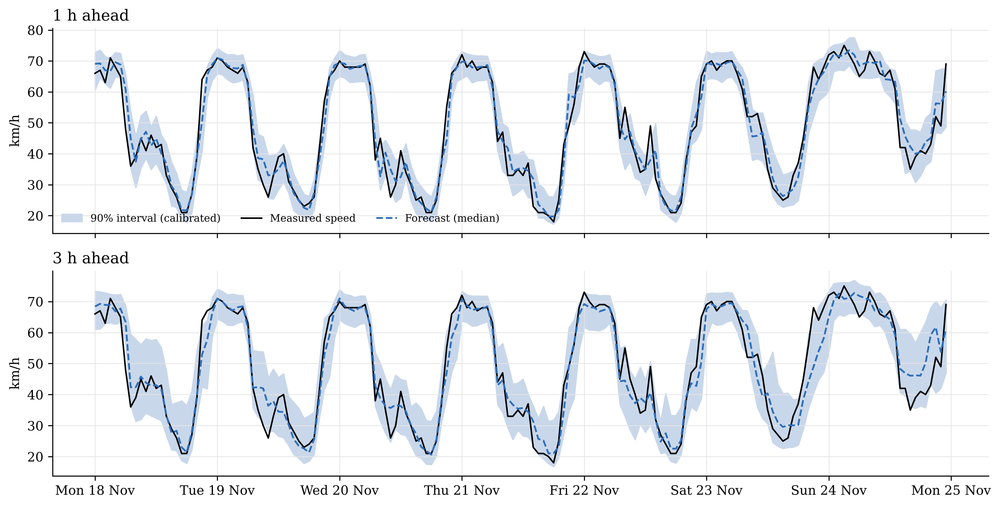
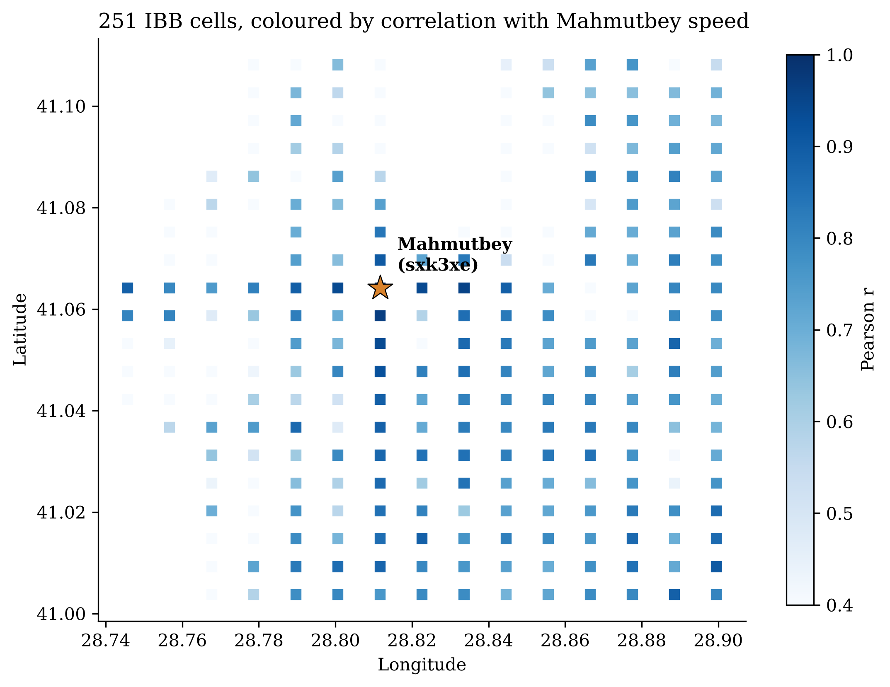
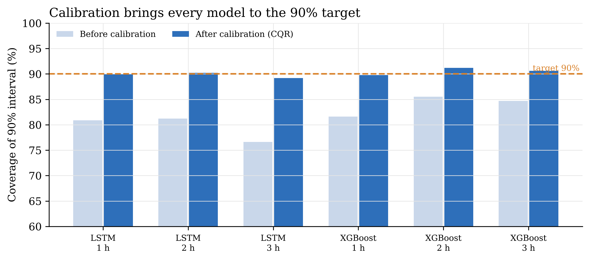

# Mahmutbey Traffic Forecast

[](https://github.com/sfeyzayildiz/mahmutbey-traffic-forecast/actions/workflows/ci.yml)

Forecasting the hourly average traffic speed at **Mahmutbey Junction, Istanbul**, 1 to 3 hours ahead,
with **calibrated uncertainty intervals**. Built on IBB open data with a leak-free pipeline, walk-forward
validation and reproducible experiments.

**[▶ Live demo](https://mahmutbey-traffic.streamlit.app)** — replay the test-period forecasts in your browser.

<p align="center">
  
</p>

## Results

Test period: November–December 2024, measured hours only (1,249 hours). Mean of 3 seeds.

| | 1 h ahead | 2 h ahead | 3 h ahead |
|---|---|---|---|
| **XGBoost** — MAE (km/h) | **2.72** | **3.10** | **3.32** |
| LSTM — MAE (km/h) | 2.71 | 3.17 | 3.42 |
| Seasonal naive (same hour last week) | 4.62 | 4.62 | 4.62 |
| Persistence (speed stays the same) | 5.14 | 8.41 | 11.49 |
| 90% interval coverage, after calibration | 90% | 91% | 91% |

- **XGBoost is the main model:** as accurate as the LSTM on the test period, better in 17 of 18 walk-forward months, and much faster to train.
- **Neighbouring road cells** lower the error by 2–5%; the **Turkish calendar** (holidays, Ramadan, iftar, school days) matters more at longer horizons. Weather and fuel price events add no measurable gain.
- **Raw quantile intervals were too narrow** (77–86% coverage). Conformalized quantile regression brings them to **89–91%**.
- The model is most accurate in stable traffic and weakest at **regime transitions**, when congestion starts or clears.

<p align="center">
  
  
</p>

## How it works

| Step | Notebook | What happens |
|---|---|---|
| 01 | [Data exploration](notebooks/01_data_exploration.ipynb) | Data quality checks (outages, impossible speeds, time zones), traffic regimes, capacity drop, calendar effects |
| 02 | [Data processing](notebooks/02_data_processing.ipynb) | Time-based split, suspect hours, neighbour selection, gap filling with flags, weather and calendar |
| 03 | [Feature engineering](notebooks/03_feature_engineering.ipynb) | 49 features for 1–3 h horizons, with a test that no future data leaks into them |
| 04 | [Training (Colab)](notebooks/04_training_colab.ipynb) | 204 runs on a GPU: baselines, XGBoost, LSTM, ablations, 3 seeds, walk-forward; tracked with MLflow |
| 05 | [Results](notebooks/05_results.ipynb) | Accuracy, stability, ablation, interval calibration, error analysis, ideas for improvement |

Rules followed throughout: everything learned from data (scalers, typical speeds, neighbour choice) uses the training
period only; filled hours are never used as targets; only information available at forecast time is used.

## Run it

```bash
git clone https://github.com/sfeyzayildiz/mahmutbey-traffic-forecast
cd mahmutbey-traffic-forecast
pip install -r requirements.txt
```

**Demo app** (replays the test-period forecasts):
```bash
streamlit run app/app.py
# or with Docker
docker build -t mahmutbey-demo . && docker run -p 8501:8501 mahmutbey-demo
```

**Experiment tracking** (every run, with parameters and metrics):
```bash
mlflow ui --backend-store-uri sqlite:///results/mlflow.db
```

**Tests** (data quality, chronological split, measured-only targets, no future leakage, calibration, demo app):
```bash
pytest -q
```
They run automatically on every push, together with a Docker build of the demo (GitHub Actions).

**Reproduce the experiments:** open `notebooks/04_training_colab.ipynb` in Google Colab with a GPU runtime.
Test results in `results/results.csv` are reproduced exactly by `src/export_predictions.py`.

## Repository

```
app/            Streamlit demo
data/raw/       IBB traffic (251 cells), weather, fuel events — see data/README.md
figures/        all figures (300 dpi)
notebooks/      01–05
results/        results.csv, mlflow.db, calibration predictions
src/            data loading, processing, features, models, training, calibration
tests/          pipeline tests (run in CI)
```

## Data and licences

- Traffic: [IBB Open Data Portal](https://data.ibb.gov.tr/dataset/hourly-traffic-density-data-set), İBB Open Data License v1.0
- Weather: [Open-Meteo](https://open-meteo.com/), CC BY 4.0
- Fuel price events: derived from public daily fuel prices

This project is independent and not endorsed by İstanbul Büyükşehir Belediyesi. Details in [data/README.md](data/README.md).
The code is released under the [MIT License](LICENSE).

## Author

**Sümmeyye Feyza Yıldız** · Physics Engineering, İstanbul Medeniyet University

This repository is a rebuilt and extended version of the author's earlier study. An AI assistant (Claude) helped with parts of the code.
